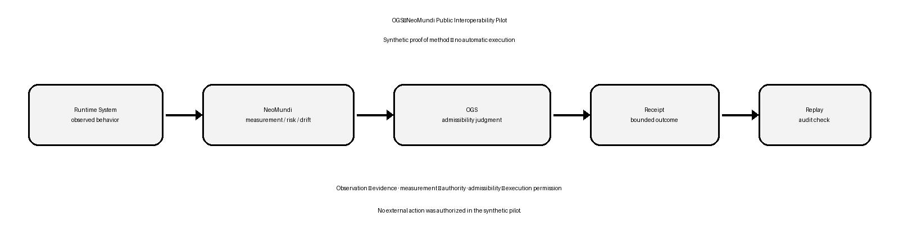

# OGS–NeoMundi Public Interoperability Pilot

> Runtime observation does not create execution authority.

This repository demonstrates how synthetic NeoMundi-style runtime measurements can become bounded OGS governance objects, receipts, and replayable decisions.

## Roles

- **NeoMundi** supplies runtime observation, risk, variation, and drift signals.
- **OGS** evaluates what those signals may legitimately support and prohibits unsupported downstream use.

## Verified synthetic result

Five synthetic observation payloads were processed through an explicit admissibility mapping. Five corrected payload-bound receipts were generated. Internal deterministic replay reproduced all five documented classifications under the same payloads and explicit rules. No external action was authorized.

**Synthetic, internally verified, not independently reproduced, and not production-derived.**

## Architecture



```text
NeoMundi observation
→ OGS admissibility evaluation
→ bounded reliance / hold / no-bind
→ receipt
→ replay
```

## Sample flows

- [`NM-OBS-001`](sample_objects/NM-OBS-001.json) → [`OGS-GOV-001`](sample_objects/OGS-GOV-001.json) → [`OGS-RCPT-001`](sample_objects/OGS-RCPT-001.json) → [`OGS-RPL-001`](sample_objects/OGS-RPL-001.json)
- [`NM-OBS-004`](sample_objects/NM-OBS-004.json) → [`OGS-GOV-004`](sample_objects/OGS-GOV-004.json) → [`OGS-RCPT-004`](sample_objects/OGS-RCPT-004.json) → [`OGS-RPL-004`](sample_objects/OGS-RPL-004.json)

## Verify

```bash
python3 scripts/verify_public_pack.py
```

## Read first

- [Use case](docs/USE_CASE.md)
- [Architecture](docs/ARCHITECTURE.md)
- [Evidence summary](docs/EVIDENCE_SUMMARY.md)
- [Claim boundary](docs/CLAIM_BOUNDARY.md)
- [Limitations](docs/LIMITATIONS.md)
- [Ownership and attribution](docs/OWNERSHIP_AND_ATTRIBUTION.md)


## Brand assets

- [NeoMundi logo](assets/neomundi_logo.png)
- [Judicator logo](assets/ogs_or_judicator_logo.png)

Both assets are included for this joint demonstration only. Trademark and ownership rights remain with their respective owners.

## Public evidence filenames

Public filenames use **Synthetic Pilot**. Historical private-pilot names inside recorded evidence and frozen archives are preserved for provenance. See the [filename migration record](docs/PUBLIC_FILENAME_RENAMES_2026-11-13.md) for the four old-to-new paths and byte-preservation checks.
