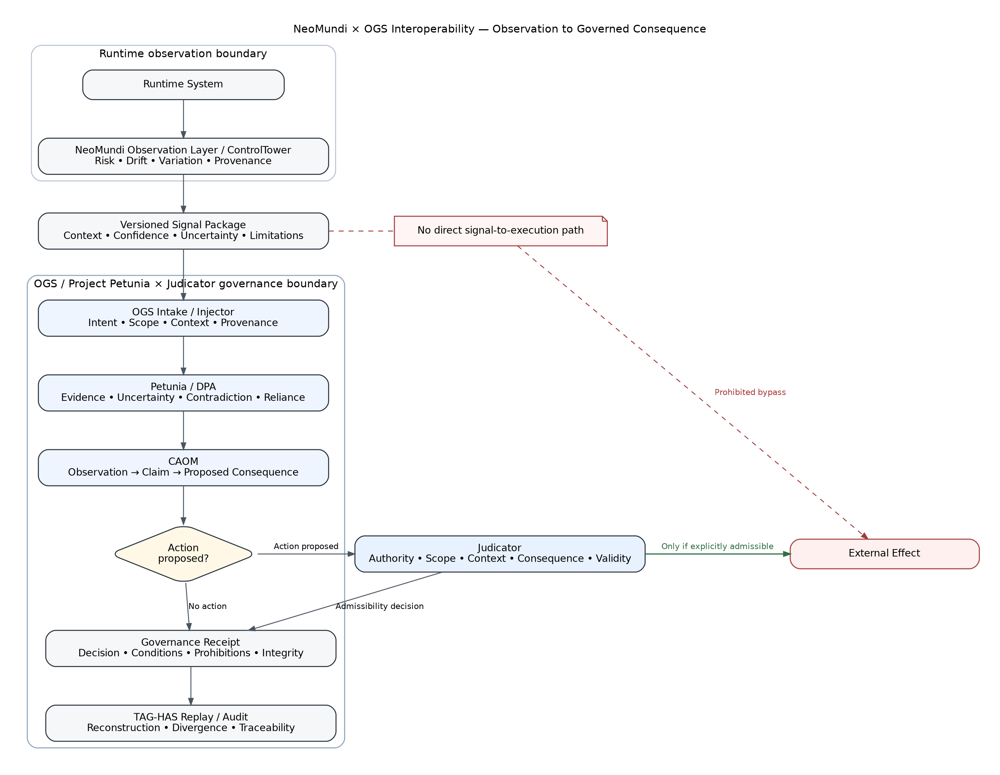

# Measurement Is Not Authority

## NeoMundi × Operational Governance Systems Interoperability Pilot

**Release:** `v1.1.0-rc.1`  
**Status:** Public-release candidate — final publication pending joint NeoMundi/OGS sign-off  
**Evidence class:** Synthetic, internally verified proof of method  
**Independent reproduction:** Not performed  
**Production evidence:** Not claimed  
**External execution authorized by the verified pilot:** `0`

> **NeoMundi observes. OGS adjudicates what the observation may become.**

This repository presents a public-safe interoperability pilot between **NeoMundi** and **Operational Governance Systems (OGS) / Project Petunia × Judicator**.

The pilot addresses a specific systems-governance problem: runtime telemetry, anomaly scores, risk indicators, and drift measurements are often treated as though they directly justify operational intervention, public assurance, compliance conclusions, or automated execution. The pilot preserves a boundary between **observation** and **authorized consequence**.

## Controlled public claim

> Five synthetic NeoMundi-style observation payloads were processed through an explicit OGS admissibility mapping. Five corrected payload-bound receipts were generated, and an internal deterministic replay reproduced all five documented classifications under the same payloads and explicit rules. No external action was authorized. The result is synthetic, internally verified, and not independently reproduced or production-derived.

## Architecture



```text
Runtime behavior
→ NeoMundi observation
→ structured signal package
→ OGS admissibility evaluation
→ bounded reliance / review / refusal / no-bind
→ governance receipt
→ replay and audit
```

The public architecture preserves the following non-collapse rules:

```text
observation ≠ evidence
risk score ≠ truth
drift signal ≠ authority
measurement ≠ admissibility
admissibility ≠ execution permission
receipt ≠ certification
```

## Start here

1. [`START_HERE.md`](START_HERE.md)
2. [`docs/PUBLICATION_GATE.md`](docs/PUBLICATION_GATE.md)
3. [`docs/PUBLIC_CLAIM_BOUNDARY.md`](docs/PUBLIC_CLAIM_BOUNDARY.md)
4. [`docs/ARCHITECTURE.md`](docs/ARCHITECTURE.md)
5. [`docs/RESULTS_AND_EVIDENCE.md`](docs/RESULTS_AND_EVIDENCE.md)
6. [`docs/APPROVAL_CHECKLIST.md`](docs/APPROVAL_CHECKLIST.md)

## Repository contents

| Area | Purpose |
|---|---|
| `docs/` | Public specification, architecture, method, limitations, claim boundary, ownership, and publication controls |
| `sample_objects/` | Two internally consistent **illustrative** signal-to-receipt trajectories; not historical pilot artifacts |
| `schemas/` | Minimal public-safe JSON Schemas for the illustrative interface |
| `evidence/` | Corrected evidence determination, evidence-pack reference, and historical-disclosure record |
| `diagrams/` | Mermaid, Graphviz, SVG, and PNG architecture representations |
| `scripts/` | Standard-library repository integrity and public-example verifier |
| `extras/` | GitHub metadata, release copy, launch copy, partner sign-off request, and profile README draft |

## Verify the repository

```bash
python3 scripts/verify_repository.py
```

The verifier checks repository hashes, JSON parsing, public-example integrity digests, object cross-links, and the presence of the claim boundary. It **does not** independently reproduce the private pilot or validate NeoMundi measurements.

## Publication posture

This package should first be uploaded to a **private GitHub repository**. Make it public only after the joint-approval gate in [`docs/PUBLICATION_GATE.md`](docs/PUBLICATION_GATE.md) is satisfied.

No logos or proprietary source code are included. Brand artwork, exact NeoMundi technical wording, release date, and any decision to attach the corrected evidence archive remain subject to partner approval.

## Attribution

> Joint public interoperability demonstration by NeoMundi and Operational Governance Systems / Project Petunia × Judicator.

See [`docs/ATTRIBUTION_AND_IP.md`](docs/ATTRIBUTION_AND_IP.md). No transfer of either party's pre-existing intellectual property is intended or implied.

## Citation

See [`CITATION.cff`](CITATION.cff) and [`docs/CITATION.md`](docs/CITATION.md).

## Rights and limitations

No open-source or implementation license is granted by this repository. See [`LICENSE.md`](LICENSE.md), [`NOTICE.md`](NOTICE.md), and [`docs/LIMITATIONS.md`](docs/LIMITATIONS.md).
